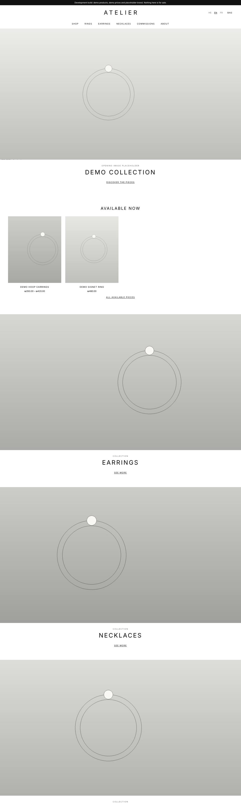
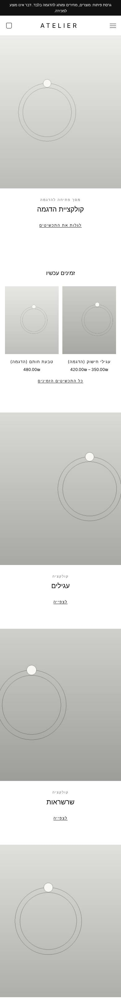
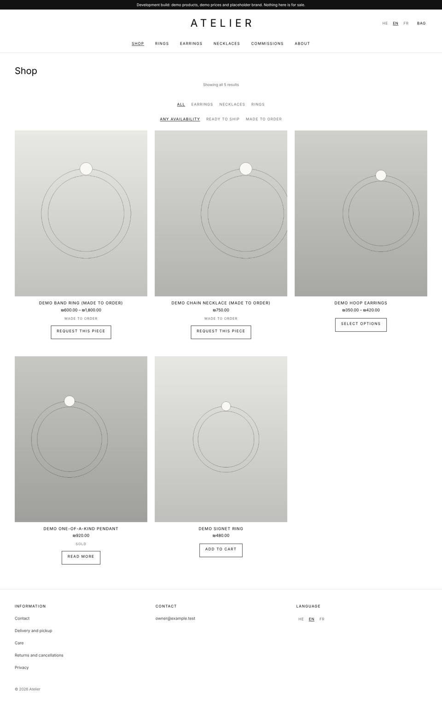
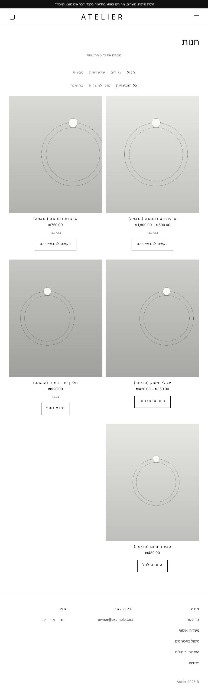
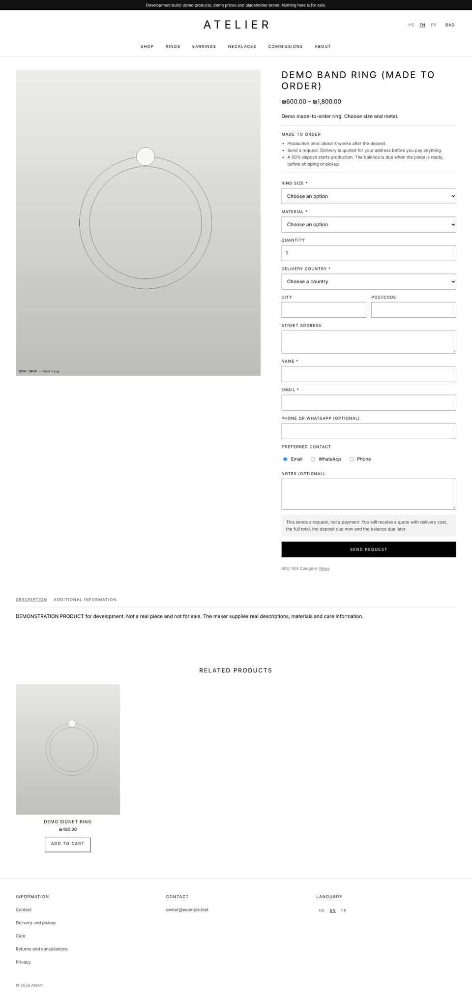
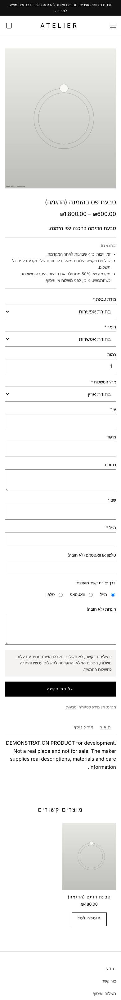
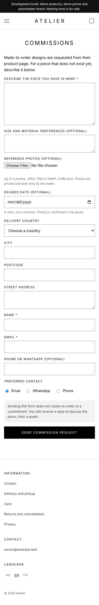
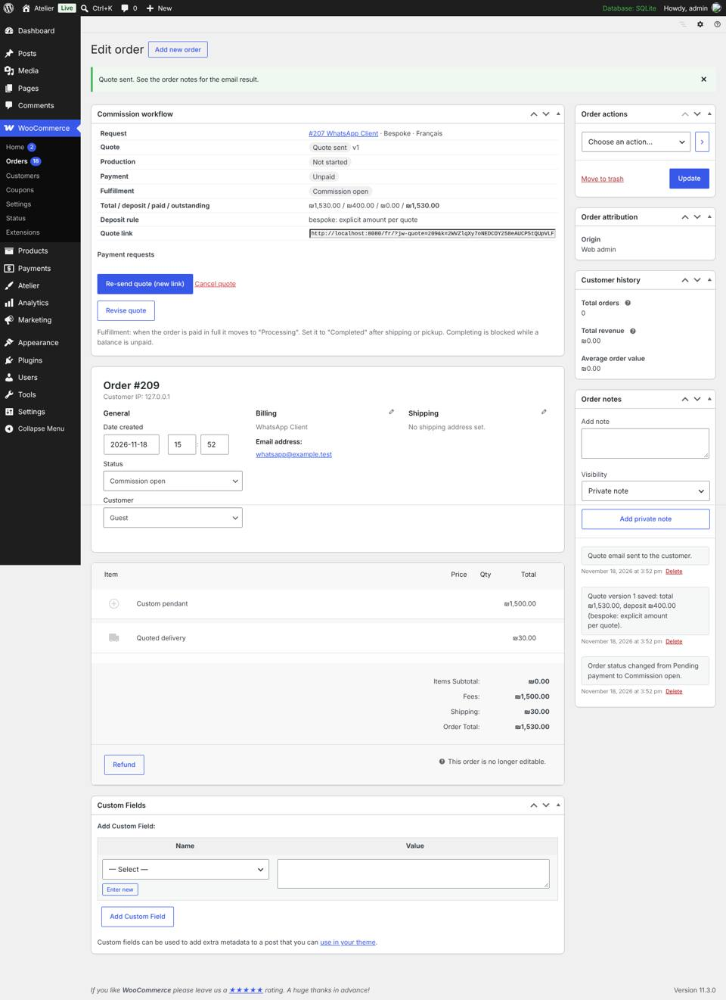
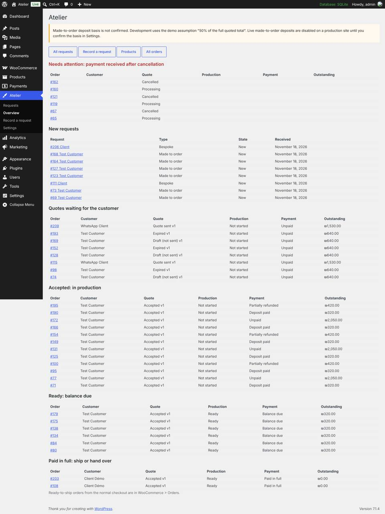

# Commerce validation

Last run: 2026-11-18, local development build.

## Tested versions

| Component | Version | Note |
|---|---|---|
| WordPress | 7.1.4 | pinned in `.env.example` |
| WooCommerce | 11.3.0 | pinned in `.env.example` |
| PHP | 8.3.6 | |
| Database (local) | SQLite via WordPress "SQLite Database Integration" 3.1.3 | WooCommerce used the posts-table order storage on this database |
| Database (CI) | MySQL 8.0 | `.github/workflows/ci.yml`; order storage as WooCommerce chooses for a new install |
| Browser | Chromium via Playwright 1.63.0 | |
| Payment | DEMO gateway (development only) | signed server-to-server callback, see below |
| Mail | Sandbox (files in `.dev/mail/`) | no real email sent |

## Results

| Suite | Command | Result |
|---|---|---|
| Integration (inside WordPress, real database and WooCommerce objects) | `tests/run-integration.sh` | **112 passed, 0 failed** |
| Browser flows (checkout, race, made to order, balance, commission upload) | `npm run test:flows` | **32 passed, 0 failed** |
| Owner workspace (admin UI) | `npm run test:admin` | **15 passed, 0 failed** |
| Responsive / RTL (360, 390, 768, 1440 px × English, Hebrew × 7 pages, mobile menu) | `npm run test:visual` | **all passed**: no horizontal overflow, `dir="rtl"` in Hebrew, every page has an h1, all images have alt text, mobile tap targets ≥ 40 px |
| CI on MySQL | GitHub Actions | runs on push; see the Actions tab for the latest result |

## GDD §10 acceptance tests

| Test | Covered by | Result |
|---|---|---|
| Ready-stock purchase | flows: cart → checkout → DEMO payment → order | Pass. Israel rate ₪30 shown before payment; total 480 + 30 = 510; order `processing` only after the signed callback; stock 3 → 2; customer language recorded. |
| Quantity-one race | integration (reservation) + flows (two browsers press "Place order" together) | Pass. Exactly one buyer reaches payment. The other sees "Not enough units of … are available in stock". Stock ends at 0, product shows "Out of stock". |
| Abandoned / failed payment | integration + flows | Pass. Declined payment → order `failed`, unpaid. Expired hold → WooCommerce cancels the unpaid order, the reservation is released, stock never reduced. |
| Late or duplicate callback | integration | Pass. Three identical callbacks reduce stock once. A late payment after the hold expired and the piece sold elsewhere does not drive stock to −1 and is flagged once. A payment on a cancelled order keeps it cancelled, keeps the transaction id, flags it. |
| Made-to-order quote | integration + flows | Pass. Size, metal, quantity, country and language survive the request. No payment and no order exist before the quote. Not purchasable through the cart. |
| 50% deposit | integration + flows | Pass. 600 + 40 delivery → deposit 320 (demo basis "full total"); merchandise basis → 300. Browser: 1,800 + 120 → deposit 960 on the payment page. |
| Bespoke deposit | integration + admin | Pass. A bespoke quote without a deposit amount is refused. 2,000 + 50 with deposit 500 → payment request 500 (not 1,025). |
| Mark ready | integration + flows | Pass. One balance request, one email with the payment link in the customer's language (`/he/…order-pay…`). |
| Repeated ready action | integration + flows | Pass. Same request reused, no second email, still one balance request. |
| Mail failure | integration | Pass. Failure returned, stored on the request and written to the order timeline. Retry reuses the same request; both attempts recorded. |
| Balance payment | integration + flows | Pass. Paid = full total counted once (duplicate callback ignored), outstanding 0, order moves to `processing`, not shipped automatically. Paid link cannot be paid again. |
| Unpaid balance | integration | Pass. Setting the order to Processing or Completed while a balance is unpaid is reverted with a note. |
| Quote revision / cancellation | integration | Pass. Revision cancels the old deposit request and invalidates the old quote link. Cancelled quotes cannot be accepted. A quote with a payment cannot be revised or cancelled without a refund first. |
| Refund | integration | Pass. Refund of 100 on a 320 deposit → paid 220, outstanding 420, state "partially refunded". Stock is not changed by commission refunds (made-to-order items do not use stock). |
| Mixed order types | design + integration | Pass. Made-to-order items cannot enter the cart; separate request form; cart contents untouched. |
| Language change | integration + flows | Pass. Cart (with a variation) survives switching to `/he/`; same product, price and stock in all languages; translated names, categories, option labels; payment and quote links carry the customer language. |
| Hebrew / mobile | visual | Pass. RTL layout, no overflow at 360–1440 px, functional mobile menu (Escape closes it). |
| Private upload | flows | Pass. Non-image upload rejected with a message and the brief kept. Photo stored outside the web root; anonymous request to the handler refused; no public URL serves it; not in the Media Library. |
| Missing production data | integration + review | Pass for shipping: unconfigured countries get no rate (no free shipping). Policies, contact details and brand are visible placeholders. Live payment not active. Made-to-order quotes are blocked on a production site until the deposit basis is confirmed. |
| Reproducible setup | `scripts/setup-dev.sh` from an empty checkout | Pass locally (SQLite). CI does the same on MySQL. |

## Payment provider

| Item | Status |
|---|---|
| PayPlus plugin 8.3.4 (wordpress.org) | Installs and activates next to this plugin; site pages load; integration tests still pass with it active. It calls `payment_complete()` (which drives the deposit/balance reconciliation) and handles the order-pay page. |
| PayPlus HPOS declaration | **Not found** in the plugin code. If WooCommerce reports it incompatible, either keep the posts order storage or ask PayPlus. |
| Real transactions, refunds through the gateway, callback signatures | **Blocked**: needs a PayPlus (or other Israeli provider) sandbox account and credentials. |
| What to test when credentials exist | One ready-stock order, one made-to-order deposit and balance, one bespoke deposit, one refund, one declined card, one duplicate callback; confirm that only the provider's server callback marks an order paid. |

## Not yet verified

- Real email delivery (SPF/DKIM) on the production host.
- Performance on the production host.
- Full visual comparison with the Chanel reference by a person (automated access was blocked).

## Screenshots

Taken from the test run (demo content). Full set: run `npm run test:visual`, output in `tests/e2e/output/`.

| | |
|---|---|
| Home, desktop, English |  |
| Home, phone, Hebrew (RTL) |  |
| Shop, desktop |  |
| Shop, tablet, Hebrew |  |
| Made-to-order product with request form, desktop |  |
| Made-to-order product, phone, Hebrew |  |
| Commission form, phone |  |
| Owner: commission workflow panel |  |
| Owner: Atelier overview |  |
